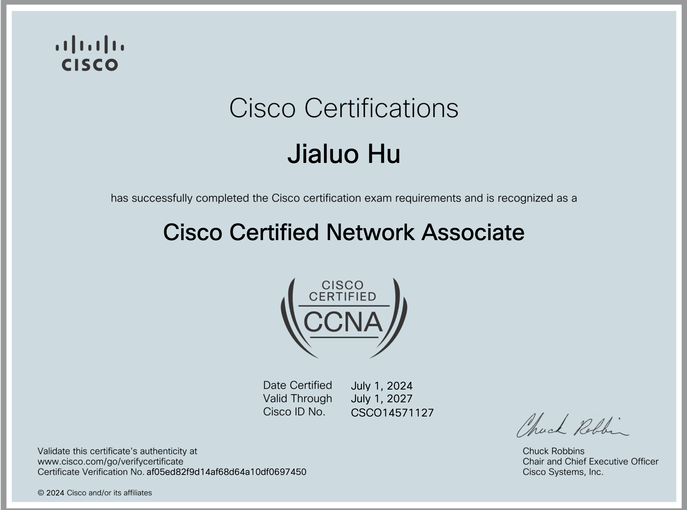

## Cisco Certified Network Associate (CCNA)
*Jul 2024*

Earners of Cisco CCNA - Implementing and Administering Cisco Solutions (CCNA) have demonstrated knowledge and skills related to network fundamentals, network access, IP connectivity, IP services, security fundamentals, and automation and programmability.

## UCI ICS Honors Program
*Jul 2023*

The ICS Honors Program (ICSHP) provides an opportunity for students in any of the Bren School’s majors to carry out a research project under the direction of a Bren School faculty member. Check more details: [https://www.ics.uci.edu/honors/](https://www.ics.uci.edu/honors/)

