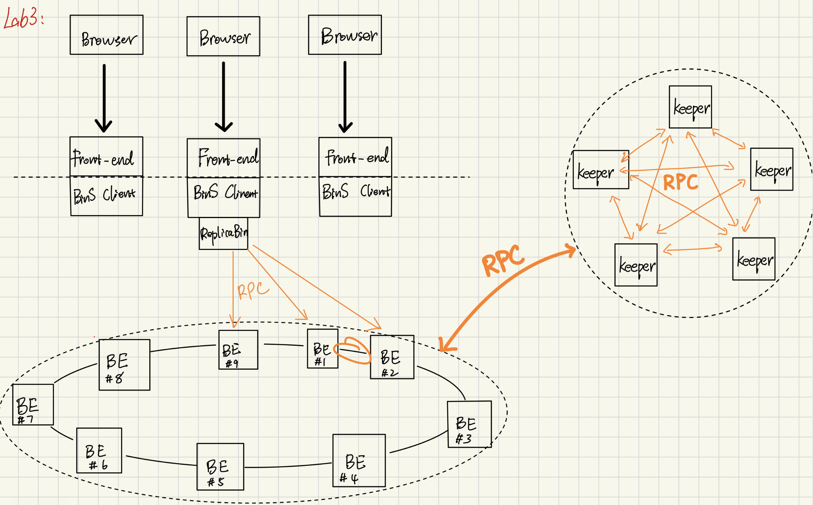
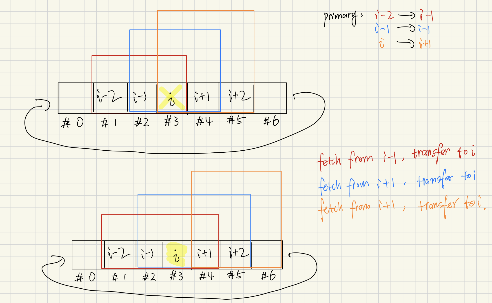
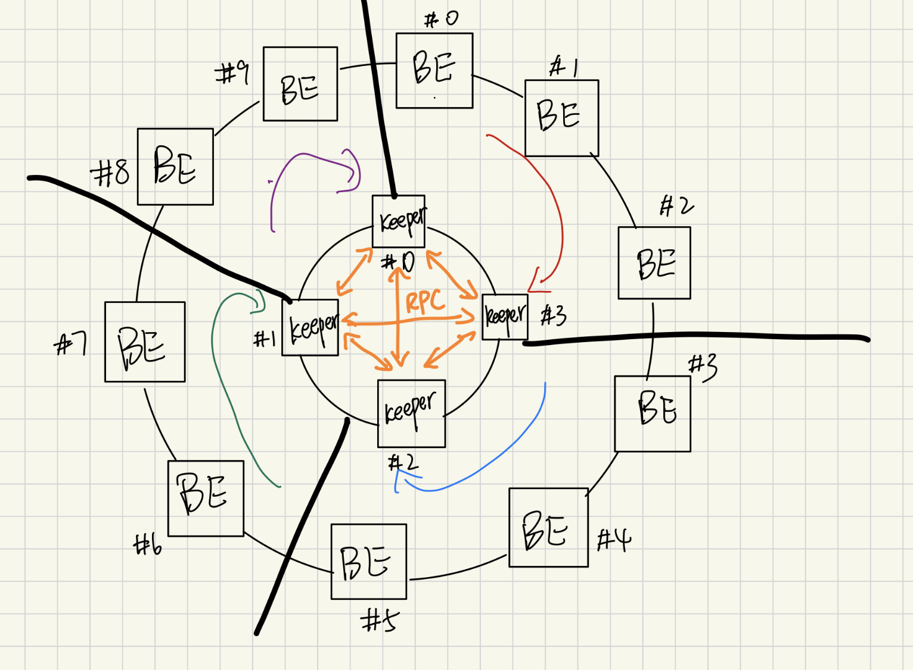

## Architecture

## Ring & Backends

We applied a structure called “Ring” which is similar to the Chord Ring to organize our Backends server. The `ReplicaBins` layer turns a loose collection of backend key‑value stores into a fault‑tolerant, quorum‑style shard that behaves like a single logical bin. Each bin is assigned to a primary + two backups by hashing the bin‐name prefix onto a sorted consistent‑hash ring. All client operations first map the prefix to its ideal server index; from there the code hunts clockwise until it reaches a live backend, as recorded in the lazily updated reachability table. Writes are turned into idempotent log entries—`clock()::action::payload`—so that even if a server rejoins half‑way through, it can replay the log and converge on the same state; helper routines like `consume_ks_log` and `consume_kl_log` fold the log stream into a final key string or list. A successful write to the primary is immediately propagated to the next two live nodes, while reads tolerate failures by linearly probing until a healthy copy is found. Throughout, the logical clocks give a total order, and key names are salted with the shard‑hash so that parallel bins never clash.

## Backend Failure & Migration & Rejoin

When a backend (BE) drops out of a three‑node replica set, the keeper initiates a fault‑specific migration routine that always preserves two in‑sync copies of every key. If the failed node was Backup #2 (**case 1**) the keeper scans counter‑clockwise around the consistent‑hash ring until it reaches the first previous live BE, pulls the entire key/list log that logically belongs to the lost hash range, then scans clockwise to the first next live BE and streams the data into that host—restoring the replica trio without touching the primary’s copy. If Backup #1 dies (**case 2**) the search direction flips: the keeper walks clockwise to the first next live BE to harvest authoritative state, then continues one more hop to the next‑next live BE and installs the data there, again re‑establishing two backups on distinct machines. If the primary fails (**case 3**) availability is most critical, so the keeper immediately promotes the first next live BE by copying its state, then skips one extra replica (to avoid mirroring the same physical box) and pushes the payload into the next‑next‑next live BE, thereby electing a fresh primary and rebuilding both backups in a single pass. In all three scenarios the algorithm relies only on liveness probes and idempotent full‑state transfers, guaranteeing that every hash partition ends the repair cycle with a healthy primary plus two up‑to‑date backups, independent of where the failure occurred. Rejoin will be similar way. The graph is attached below.

## Ring & Keepers & Solutions

The Keeper layer is the distributed “control plane” that keeps every backend (BE) and fellow keeper (KP) healthy and correctly replicated. At startup each keeper hashes every BE address onto a consistent‑hash ring, and also marks itself in another ring which is used for keepers peers, and launches a lightweight gRPC server that answers one RPC request `heart_beat_check`. The main serve loop works in three phases that repeat every second:

- Heartbeat & Liveness map – `kp_heartbeats` sends the RPC to every entry in `ring_kp`, updating the backends alive table; `be_heartbeats` talks to the BE to see whether the data plane is reachable. Any unreachable BE hash is queued in `migrate_be_q`; a BE that responds but advertises `false` is scheduled in `rejoin_be_q`.
- Clock convergence – all live BEs are pinged for their Lamport clock and the maximum is fanned back out, guaranteeing that every server’s logical time only moves forward before a migration.
- Repair actions – `process_failed_be` copies the full keyspace from the surviving replicas (primary → backup 1 → backup 2 pattern) onto a brand‑new target BE; `process_rejoin_be` performs the symmetric load when a server comes back. Both routines walk the ring clockwise, retrying until either two healthy sources are found or the entire ring has been exhausted.

Our keeper layer is itself organized as a second‑level consistent‑hash ring that mirrors the backend layout, so that each keeper is responsible for the slice of backend hashes that falls between its own position and that of its predecessor. Using the same hash function for both tiers gives us a deterministic mapping: the BE that stores a key and the keeper that manages that BE are derived from the same token, eliminating any extra lookup tables. Every keeper runs a periodic heartbeat loop in two directions—one that pings the set of backends in its slice and one that pings its fellow keepers. If a backend in its jurisdiction becomes unreachable, the keeper immediately launches the migration routine described earlier to re‑replicate the data onto live nodes. If a keeper itself fails, its successor on the keeper ring detects the missing heartbeat, marks the fallen node as dead, and atomically assumes ownership of the entire backend slice that hash‑ranges to the failed keeper; because the ring is already sorted by hash, this takeover requires no global coordination—only a local expansion of the successor’s monitored range. The graph is attached below about each keeper handles part of backends.

